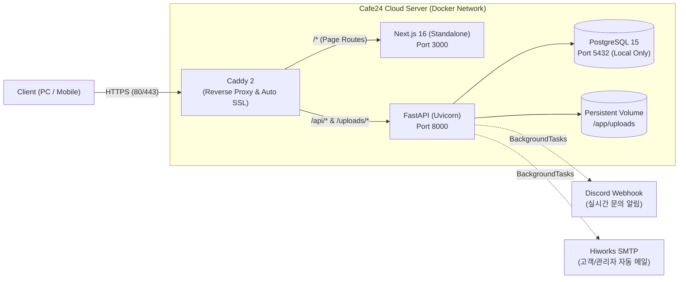

# 🛡️ GARNET IT Web — (주)가넷정보기술 공식 홈페이지 & 통합 CMS

> **엔터프라이즈 IT 보안 및 네트워크 인프라 전문 기업, (주)가넷정보기술의 차세대 반응형 웹 플랫폼**  
> B2B 고객을 위한 모던 브랜드 웹사이트와 비전공 실무자도 코드 수정 없이 콘텐츠를 운영할 수 있는 통합 관리자 시스템(CMS)을 제공합니다.


---

## 🎯 핵심 기획 및 설계 철학 (6 Pillars)

본 프로젝트는 단순한 기업 소개 페이지를 넘어, 실제 B2B 비즈니스 운영 환경에 최적화된 6가지 핵심 원칙을 바탕으로 설계되었습니다.

1. **Modern B2B Identity**: 가넷 레드(`#C1121F`)와 다크 슬레이트(`#1E293B`) 컬러 시스템, Pretendard 가변 폰트, 풀스크린 히어로 비디오를 결합한 현대적인 B2B UI/UX
2. **Seamless Responsive Design**: 데스크톱, 태블릿, 스마트폰 모든 디바이스에 대응하는 반응형 그리드, 모바일 전용 드로어(Sheet) 내비게이션 및 터치 스와이프 인터랙션
3. **Enterprise-Grade Security**: 자동 HTTPS(TLS), JWT + `bcrypt` 단방향 암호화, RBAC(역할 기반 권한 제어), 유휴 시간 자동 로그아웃(Idle Timeout), 파일 업로드 검증 및 DB 포트 격리
4. **No-Code Admin CMS**: 비전공자도 직관적으로 제품·카탈로그·공지사항·자료실·FAQ·온라인 문의를 관리할 수 있는 전용 백오피스 제공
5. **Real-Time Notification Automation**: 고객 온라인 문의 접수 즉시 **Discord 실시간 웹훅 알림** 및 **Hiworks SMTP 이메일(고객 확인용 + 관리자 리포트용) 비동기 자동 발송**
6. **Containerized Infrastructure**: 단일 가상 호스트(Cafe24 VPS) 위에서 Caddy, Next.js(Standalone), FastAPI, PostgreSQL이 독립된 컨테이너로 유기적으로 동작하는 Docker 아키텍처

---

## 🏗️ 시스템 아키텍처 (System Architecture)



---

## ✨ 주요 기능 (Key Features)

### 1. 고객용 웹사이트 (`(main)`)
* **메인 홈 (`/`)**
  * 디바이스별 최적화 배경 영상(`HeroSection`) 및 핵심 비즈니스 영역 쇼케이스(`BusinessSection`)
  * 관리자 추천(Featured) 나라장터 우수제품 동적 연동(`ProductShowcase`)
  * `requestAnimationFrame` 기반 자동 무한 롤링 + 모바일 터치 스와이프 + 전체 파트너사 모달을 지원하는 파트너 배너(`BannerSection`)
* **회사소개 (`/company/[category]`)**
  * CEO 인사말, 기업 연혁, 인증 및 특허(클릭 시 원본 확대 라이트박스 모달), 오시는 길(Kakao Map API 연동)
* **사업영역 (`/business/[category]`)**
  * 지능형 영상 감시 체계(CCTV), 네트워크 및 보안 인프라, 재난 예경보 시스템, SI 및 통합 유지보수 소개
* **제품소개 (`/product` & `/product/detail/[id]`)**
  * 카테고리별(CCTV, 네트워크/보안, 방송장비) 필터링 및 검색
  * 제품 상세 스펙, 주요 특징 아이콘 시각화, 공식 PDF 카탈로그 즉시 다운로드
* **고객지원 센터 (`/support/[category]`)**
  * **통합 검색 (Unified Search)**: 키워드 한 번 입력으로 `Promise.all` 병렬 통신을 통해 공지사항·자료실·FAQ 3대 영역을 동시 검색
  * **공지사항 (`notice`)**: 상단 고정(Pin) 공지 우선 정렬 및 실시간 조회수 카운팅
  * **자료실 (`download`)**: 카탈로그·매뉴얼·소프트웨어 분류별 검색, 파일 다운로드 및 누적 다운로드 횟수 집계
  * **묻고 답하기 (`faq`)**: 카테고리별 아코디언(Accordion) Q&A
  * **온라인 문의 (`inquiry`)**: 개인정보 수집 동의 검증, 접수 시 백그라운드 큐(`BackgroundTasks`)를 통한 디스코드 알림 및 고객·관리자 양방향 HTML 이메일 자동 발송

### 2. 통합 관리자 시스템 (`/garnet-adm`)
* **종합 관제 대시보드 (`/garnet-adm/dashboard`)**
  * 5대 핵심 도메인 실시간 병렬 집계 KPI 카드 (미처리 문의, 등록 제품 수, 누적 다운로드 수, 고객지원 콘텐츠 수)
  * `Recharts` 기반 실데이터 시각화: **최근 7일간 온라인 문의 접수 추이(AreaChart)** 및 **인기 자료실 다운로드 TOP 5(BarChart)**
* **제품 관리 (`/garnet-adm/dashboard/products`)**
  * 제품 썸네일 및 PDF 카탈로그 파일 업로드, 주요 특징(Features) 및 상세 스펙(Specs) 동적 배열 편집, 메인 노출(`is_featured`) 및 정렬 순서 제어
* **게시판 통합 관리 (`/garnet-adm/dashboard/boards/*`)**
  * 공지사항, 자료실, FAQ 등록/수정/삭제 및 공개 여부 토글
  * 온라인 문의 접수함 상세 열람 및 처리 완료(`is_resolved`) 상태 관리
* **관리자 계정 및 권한 관리 (`/garnet-adm/dashboard/users`)**
  * 내 비밀번호 변경 (현재 비밀번호 검증 후 `bcrypt` 재해싱)
  * 최고관리자(`SUPERADMIN`) 전용 사내 관리자(`EDITOR` / `SUPERADMIN`) 계정 생성·수정·삭제 및 계정 정지(`is_active`) 제어
  * 본인 계정 스스로 삭제·강등·비활성화 방지 안전장치(Safety Guard) 적용

---

## 🔒 보안 설계 (Security Highlights)

| 보안 영역 | 적용 기술 및 방어 로직 |
| :--- | :--- |
| **네트워크 & 전송 구간** | • `Caddy 2` 리버스 프록시를 통한 전 구간 자동 HTTPS(TLS) 암호화<br>• `docker-compose.yml` 내 PostgreSQL 포트를 `127.0.0.1:5432:5432`로 바인딩하여 외부 직접 접속 원천 차단 |
| **인증 및 세션 관리** | • `passlib(bcrypt)` 단방향 해싱 및 `PyJWT(HS256)` 서명 토큰 기반 인증<br>• 비활성화(`is_active=False`) 계정의 로그인 및 API 호출 차단<br>• `useIdleTimeout` 커스텀 훅을 통한 **10분 무동작 시 자동 로그아웃** 및 타이머 표시 |
| **파일 업로드 보안** | • 관리자 JWT 인증(`Depends(get_current_active_user)`) 필수 적용<br>• `os.path.basename`을 통한 경로 조작(Path Traversal) 방지 및 화이트리스트 확장자 검증 + UUID 난수 파일명 저장 |
| **XSS & Injection 방어** | • SQLAlchemy ORM 파라미터 바인딩을 통한 SQL Injection 방어<br>• 이메일 HTML 템플릿 생성 시 `html.escape()` 처리를 통한 XSS 스크립트 삽입 방어 |

---

## 📂 디렉터리 구조 (Directory Structure)

```text
garnetit-web/
├── Caddyfile                   # Caddy 리버스 프록시 및 자동 HTTPS 설정
├── docker-compose.yml          # 멀티 컨테이너 오케스트레이션 (Caddy, Frontend, Backend, DB, Portainer)
├── .env.example                # 환경변수 템플릿
├── backend/                    # FastAPI 백엔드 서버
│   ├── Dockerfile
│   ├── requirements.txt
│   ├── alembic/                # DB 스키마 마이그레이션 버전 관리
│   └── app/
│       ├── main.py             # FastAPI 엔트리포인트 및 라우터 마운트
│       ├── config.py           # Pydantic Settings 기반 환경변수 로드
│       ├── database.py         # SQLAlchemy 엔진 및 세션 설정
│       ├── core/security.py    # bcrypt 해싱 및 JWT 토큰 생성/검증
│       ├── dependencies/       # DB 세션 및 JWT 인증 검문소(Guard)
│       ├── models/             # SQLAlchemy ORM 모델 (User, Product, Notice, Download, Faq, Inquiry 등)
│       ├── schemas/            # Pydantic Request/Response 데이터 검증 스키마
│       ├── routers/            # 도메인별 REST API 엔드포인트
│       └── services/           # Discord 웹훅 및 Hiworks SMTP 이메일 발송 서비스
└── frontend/                   # Next.js 16 (App Router) 프론트엔드
    ├── Dockerfile              # Standalone 경량화 멀티 스테이지 빌드
    ├── next.config.ts          # Standalone 출력 및 API/Uploads 리라이트 프록시
    ├── public/                 # 정적 에셋 (파트너 로고, 배경 비디오, 인증서 등)
    └── src/
        ├── app/
        │   ├── (main)/         # 고객용 페이지 (홈, 회사소개, 사업영역, 제품소개, 고객지원, 개인정보처리방침)
        │   ├── garnet-adm/     # 관리자 전용 페이지 (로그인, 대시보드, 제품/게시판/계정 관리)
        │   ├── layout.tsx      # 전역 메타데이터(OpenGraph) 및 Pretendard 로컬 폰트 설정
        │   ├── robots.ts       # 검색엔진 크롤러 규칙 (/garnet-adm/ 차단)
        │   └── sitemap.ts      # 동적 Sitemap.xml 생성
        ├── components/         # 공통 레이아웃, 메인 섹션, 관리자 가드 및 Shadcn UI 컴포넌트
        └── hooks/              # 유휴 시간 감지(useIdleTimeout) 등 커스텀 훅
```

---

## 🚀 실행 및 배포 가이드 (Getting Started & Deployment)

### 1. 환경변수 설정 (`.env`)
프로젝트 루트 및 `backend/.env`에 아래 환경변수를 구성합니다.

```env
# PostgreSQL 설정
POSTGRES_USER=garnetadmin
POSTGRES_PASSWORD=your_secure_password
POSTGRES_DB=garnetdb

# JWT 보안 키
SECRET_KEY=your_jwt_secret_key

# 카카오맵 API 키 (프론트엔드 빌드 인자)
NEXT_PUBLIC_KAKAO_MAP_API_KEY=your_kakao_javascript_key

# 알림 연동 (Discord Webhook & Hiworks SMTP)
DISCORD_WEBHOOK_URL=https://discord.com/api/webhooks/...
SMTP_SERVER=smtps.hiworks.com
SMTP_PORT=465
SMTP_USER=admin@garnetit.co.kr
SMTP_PASSWORD=your_smtp_password
SMTP_FROM_NAME=가넷정보기술 고객지원센터
ADMIN_EMAIL=garnet@garnetit.co.kr
```

### 2. 로컬 개발 환경 실행

```bash
# 1) 백엔드 실행 (Python 가상환경 활성화 후)
cd backend
pip install -r requirements.txt
alembic upgrade head
uvicorn app.main:app --reload --port 8000

# 2) 프론트엔드 실행 (새 터미널)
cd frontend
npm install
npm run dev
```

### 3. 실서버(Cafe24) Docker 운영 배포

로컬에서 Git 커밋 및 푸시 후, 실서버에서 Docker Compose를 통해 무중단 재빌드 배포를 수행합니다.

```bash
# 1) 로컬 개발 PC (Git Bash)
git add .
git commit -m "feat: 변경사항 요약"
git push origin main

# 2) Cafe24 실서버 (SSH 접속 후)
git pull origin main
docker compose up -d --build
```

---

## 📄 License & Copyright

Copyright © 2026 **Garnet Information Technology ((주)가넷정보기술)**. All rights reserved.  
본 프로젝트의 소스 코드 및 디자인 자산은 (주)가넷정보기술의 자산입니다.